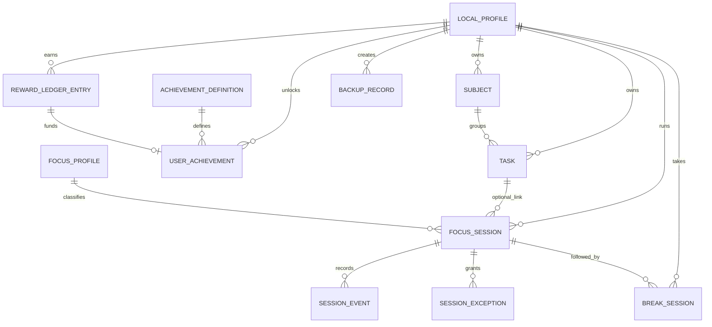

# Conceptual Data Model

**Product:** Boundless Study  
**Status:** Draft for user review  
**Version:** 0.1  
**Last updated:** 2026-11-12  
**Related:** `domain-business-rules.md`, `../04-architecture/system-architecture.md`

## 1. Purpose and scope

This is a conceptual model for the MVP. It defines entities, relationships, ownership, key constraints, retention, and migration expectations. It is not a physical Entity Framework schema and does not authorize implementation.

The model is designed to support the deferred modules without replacing the core database:

- The reward ledger supports XP now and tokens later.
- Achievements reference stable definition codes.
- Sessions and events are auditable and replayable.
- Tasks and subjects use soft deletion so history remains readable.
- The same schema is used in Full and Limited modes.

## 2. Ownership and storage

- The per-user agent is the **sole database owner** and the **only process that opens the study database**, for reads and writes.
- The WPF UI reads and writes only through the agent over a named pipe. It never opens the database file, copies it for reading, or falls back to direct access.
- The Windows service does not open the database and does not write user study data.
- The browser bridge does not open the database.
- The browser extension does not access the database.
- Default database path: `%LocalAppData%\BoundlessStudy\boundless.db`.
- Default log path: `%LocalAppData%\BoundlessStudy\Logs\`.
- Default backup path: `%LocalAppData%\BoundlessStudy\Backups\`.
- Service machine state, if needed, lives under `%ProgramData%\BoundlessStudy\` and contains no user study history.
- SQLite foreign keys are enabled.
- WAL mode is required for normal operation.
- The database is local, unencrypted by default, and readable by the Windows account and local administrators. This limitation must be disclosed.
- No browsing history, window titles, keystrokes, or page content are stored.

### 2.1 Read and write access path

- A UI read is a versioned query request with `requestId`, `correlationId`, bounded parameters, and pagination.
- The agent executes each query in a read transaction and returns a consistent WAL snapshot. Multi-page reads use a bounded snapshot lease; an expired lease returns `SNAPSHOT_EXPIRED` rather than mixing snapshots.
- Page size is bounded. The response includes the echoed request ID, a stable sort key, and `hasMore`.
- A UI write is a command with an idempotency key for mutations. The agent serializes writes and commits or rolls back completely.
- The default request timeout is 5 seconds. Long operations report progress and support cancellation by target request ID.
- Errors return a stable code, a retryable flag, and no partial mutation.
- Backup, restore, integrity checks, and migrations run only in the agent. The UI receives progress and outcomes.
- If the agent is unavailable, the UI shows a recovery state and does not open the database.

## 3. Conceptual entity relationship diagram

## 4. Entities

### 4.1 LocalProfile

One local study profile per Windows user.

| Field | Type | Notes |
|---|---|---|
| Id | GUID or integer | Primary key. |
| DisplayName | string(80) | Optional; defaults to a neutral local label. |
| CreatedAtUtc | datetime | UTC. |
| LastOpenedAtUtc | datetime | Optional. |
| CachedTotalXp | integer | Rebuildable cache derived from ledger. |
| CachedLevel | integer | Rebuildable from total XP and active level curve. |
| EconomyRuleVersion | string | Version of the reward rules used for current calculations. |
| IsOnboarded | boolean | Whether required onboarding is complete. |
| InstallationMode | enum/string | `Full` or `Limited`; display and capability state, not identity. |
| UpdatedAtUtc | datetime | UTC. |

MVP creates one profile. Multi-profile support is not included.

### 4.2 Subject

| Field | Type | Notes |
|---|---|---|
| Id | GUID or integer | Primary key. |
| LocalProfileId | FK | Required. |
| Name | string(100) | Required, trimmed. |
| Description | string(500) | Optional. |
| IsArchived | boolean | Archived subjects are hidden from new-task selection. |
| CreatedAtUtc | datetime | UTC. |
| UpdatedAtUtc | datetime | UTC. |

Constraints:

- Name is non-empty after trimming.
- Archived subjects remain available for historical display.
- Subject names need not be globally unique; duplicates are allowed but the UI warns.

### 4.3 Task

| Field | Type | Notes |
|---|---|---|
| Id | GUID or integer | Primary key. |
| LocalProfileId | FK | Required. |
| SubjectId | FK, nullable | Optional grouping. |
| Title | string(200) | Required, trimmed. |
| Notes | string(4000) | Optional. |
| DueDateLocal | date, nullable | Local calendar date. |
| EstimatedMinutes | integer, nullable | 5–600 in 5-minute increments. |
| Priority | enum | Low, Normal, High. |
| Status | enum | Todo, InProgress, Done, Archived. |
| PlannedForLocalDate | date, nullable | Manual today-planning flag. |
| CompletedAtUtc | datetime, nullable | Set on first completion. |
| CompletionRewardId | FK to ledger, nullable | Optional link for audit. |
| IsDeleted | boolean | Soft delete. |
| DeletedAtUtc | datetime, nullable | UTC. |
| CreatedAtUtc | datetime | UTC. |
| UpdatedAtUtc | datetime | UTC. |

Constraints:

- Title is non-empty.
- `EstimatedMinutes` is null or between 5 and 600, divisible by 5.
- A task can have many sessions over time.
- A task cannot be physically deleted through normal UI.
- Completion reward is created at most once.

### 4.4 FocusProfile

Seeded reference data for the three MVP profiles. It may become user-editable in a later release.

| Field | Type | Notes |
|---|---|---|
| Code | string(20) | `Flexible`, `Balanced`, `Strict`; primary key. |
| DisplayName | string(40) | Functional label. |
| EarlyExitMode | enum | Immediate, ConfirmationCooldown, TypedConfirmationCooldown. |
| EarlyExitCooldownSeconds | integer | 0, 10, or 30. |
| MaxExceptionsPerSession | integer | 0, 2, or 1. |
| ExceptionDurationSeconds | integer | 0, 300, or 120. |
| ExceptionDelaySeconds | integer | 0, 0, or 30. |
| XpPerActiveMinute | integer | 2, 3, or 4. |
| RequiresBrowserWhenSiteRulesExist | boolean | True for Strict. |
| IsEnabled | boolean | True for MVP profiles. |
| EconomyRuleVersion | string | Economy and behavior version; `ECONOMY-1` in MVP. |

### 4.5 FocusSession

| Field | Type | Notes |
|---|---|---|
| Id | GUID | Primary key. |
| LocalProfileId | FK | Required. |
| TaskId | FK, nullable | Optional link. |
| SubjectId | FK, nullable | Captured at start. |
| TaskTitleSnapshot | string(200), nullable | Stable history. |
| SubjectNameSnapshot | string(100), nullable | Stable history. |
| ProfileCode | FK | Profile used. |
| PlannedFocusSeconds | integer | 300–10,800 in 5-minute increments. |
| State | enum | Active, Blocked, SystemPaused, Completed, EndedEarly, RecoverableInterrupted, Abandoned. |
| StartedAtUtc | datetime | UTC. |
| EndedAtUtc | datetime, nullable | UTC. |
| LastCheckpointAtUtc | datetime, nullable | UTC. |
| ElapsedSeconds | integer | Monotonic-derived, checkpointed. |
| ActiveStudySeconds | integer | Monotonic-derived, checkpointed. |
| IdleSeconds | integer | Non-negative. |
| ProtectionGapSeconds | integer | Non-negative. |
| ViolationCount | integer | Non-negative. |
| ExceptionCount | integer | Non-negative. |
| RecoveryCount | integer | Non-negative. |
| ProtectionStatus | enum | NotRequired, NotConfigured, Protected, Degraded, Unavailable, Unknown. |
| VerificationStatus | enum | Verified, Degraded, Unverified. |
| EndReason | enum, nullable | Completed, UserEnded, AgentCrash, Shutdown, PowerLoss, OverlayFailure, Unknown. |
| AppRuleVersion | string | Snapshot of enforcement config. App-owned fixed label `APP-RULES-1` in the MVP (A2, approved 2026-11-19). |
| EconomyRuleVersion | string | Snapshot of the economy rule used for this session's award; `ECONOMY-1` in MVP. |
| CreatedAtUtc | datetime | UTC. |
| UpdatedAtUtc | datetime | UTC. |

Constraints:

- Planned duration is 5–180 minutes.
- Only one active focus session per local profile. A pending `RecoverableInterrupted` session counts as active: the user must Resume or Discard it, and it is automatically abandoned after 24 hours (A6, approved 2026-11-19).
- `Completed` requires `EndedAtUtc` and elapsed >= planned.
- `EndedEarly` requires an end reason other than Completed.
- `RecoverableInterrupted` may transition to Active or Abandoned.
- Terminal states cannot return to Active except `RecoverableInterrupted`.
- `ElapsedSeconds`, `ActiveStudySeconds`, `IdleSeconds`, `ProtectionGapSeconds`, and counters are non-negative.
- `ActiveStudySeconds <= ElapsedSeconds`, except for explicitly documented future passive-time modes. MVP enforces this.
- Snapshots are not updated when the task or subject is renamed.

### 4.6 BreakSession

| Field | Type | Notes |
|---|---|---|
| Id | GUID | Primary key. |
| LocalProfileId | FK | Required. |
| FocusSessionId | FK, nullable | Optional preceding focus session. |
| PlannedSeconds | integer | 60–3600. |
| State | enum | Active, Completed, EndedEarly, Interrupted. |
| StartedAtUtc | datetime | UTC. |
| EndedAtUtc | datetime, nullable | UTC. |
| ElapsedSeconds | integer | Monotonic-derived. |
| EndReason | enum, nullable | Completed, UserEnded, LockOrSleepTimeout, Shutdown, Unknown. |
| CreatedAtUtc | datetime | UTC. |
| UpdatedAtUtc | datetime | UTC. |

Constraints:

- No two active break sessions.
- A break cannot be active while a focus session is active.
- Break does not reference a reward entry.

### 4.7 SessionEvent

Append-only event record for audit, state reconstruction, and diagnostics.

| Field | Type | Notes |
|---|---|---|
| Id | GUID | Primary key. |
| SessionType | enum | Focus or Break. |
| SessionId | GUID | Logical reference; no cascade delete. |
| Sequence | integer | Monotonic per session. |
| EventType | enum/string | Start, Blocked, Unblocked, IdleStarted, IdleEnded, SystemPaused, SystemResumed, BreakStarted, BreakEnded, ExceptionGranted, ProtectionDegraded, ProtectionRestored, Recovered, Completed, EndedEarly, EnforcementFailed, RewardCreated, AchievementUnlocked, Interrupted, Abandoned. `Interrupted` and `Abandoned` are approved additive values (A4, approved 2026-11-19); all earlier values and existing history are unchanged. |
| OccurredAtUtc | datetime | UTC. |
| LocalDateAtEvent | date | Local date at event. |
| UtcOffsetMinutes | integer | Offset at event. |
| PayloadJson | text | Small structured payload; no URLs, window titles, or content. |
| CreatedAtUtc | datetime | UTC. |

Rules:

- Insert-only through the domain layer.
- No updates or deletes except a full data reset.
- `Sequence` is unique per session.
- Payloads are schema-validated and size-limited to 2,000 characters (A1, approved 2026-11-19).
- Events are not used as a substitute for checkpoints; they record state transitions and important diagnostics.

### 4.8 SessionException

| Field | Type | Notes |
|---|---|---|
| Id | GUID | Primary key. |
| FocusSessionId | FK | Required. |
| TargetType | enum | Application or Website. |
| TargetId | GUID/string | Blocked app ID or normalized domain. |
| GrantedAtUtc | datetime | UTC. |
| ExpiresAtUtc | datetime | UTC. |
| ReasonCategory | enum | Technical, Accessibility, StudyResource, Emergency, Other. |
| WasAutoExpired | boolean | Set when expiry is processed. |
| CreatedAtUtc | datetime | UTC. |

Constraints:

- Cannot exceed the profile exception count.
- Cannot exceed the profile maximum duration.
- Strict exceptions require the recorded delay.
- Expired exceptions do not remove the underlying block rule.

### 4.9 BlockedApp

| Field | Type | Notes |
|---|---|---|
| Id | GUID | Primary key. |
| LocalProfileId | FK | Required. |
| DisplayName | string(200) | User-facing label from process metadata or file. |
| NormalizedExecutablePath | string(1000), nullable | Canonical path when available. |
| NormalizedExecutableName | string(260) | Required fallback. |
| IsEnabled | boolean | Can be disabled without deletion. |
| CreatedAtUtc | datetime | UTC. |
| UpdatedAtUtc | datetime | UTC. |

Constraints:

- At least one of path or name is present.
- Path matching is case-insensitive on Windows.
- System-critical processes are rejected.
- Duplicate normalized targets are discouraged and merged by the UI.

### 4.10 BlockedSite

| Field | Type | Notes |
|---|---|---|
| Id | GUID | Primary key. |
| LocalProfileId | FK | Required. |
| NormalizedDomain | string(253) | Required. |
| DisplayName | string(253), nullable | Optional user label. |
| IsEnabled | boolean | Can be disabled without deletion. |
| CreatedAtUtc | datetime | UTC. |
| UpdatedAtUtc | datetime | UTC. |

Constraints:

- Normalized domain is lowercase, valid, and unique per profile.
- Scheme, path, query, and fragment are not stored.
- Internationalized domains are normalized to punycode in the UI layer before storage.

### 4.11 AllowedSite

| Field | Type | Notes |
|---|---|---|
| Id | GUID | Primary key. |
| LocalProfileId | FK | Required. |
| NormalizedDomain | string(253) | Required. |
| DisplayName | string(253), nullable | Optional. |
| IsEnabled | boolean | Can be disabled without deletion. |
| CreatedAtUtc | datetime | UTC. |
| UpdatedAtUtc | datetime | UTC. |

Allowed sites take precedence over blocked sites. A domain can exist in both lists; the UI must explain the precedence rather than silently deduplicate across different list types.

### 4.12 RewardLedgerEntry

Append-only ledger for XP and future token currency.

| Field | Type | Notes |
|---|---|---|
| Id | GUID | Primary key. |
| LocalProfileId | FK | Required. |
| CurrencyCode | string(10) | `XP` in MVP; `TOKEN` reserved. |
| Amount | integer | Positive. |
| SourceType | enum | SessionCompletion, SessionPartial, TaskCompletion, AchievementUnlock, Adjustment. |
| SourceId | string(100) | Session ID, task ID, achievement code, or adjustment ID. |
| IdempotencyKey | string(200) | Unique. |
| AwardedAtUtc | datetime | UTC. |
| AwardLocalDate | date | Local date used for daily cap/streak. |
| UtcOffsetMinutes | integer | Offset at award. |
| EconomyRuleVersion | string | Economy rule version that generated the entry; `ECONOMY-1` in MVP. Historical entries are never recalculated. |
| Notes | string(500), nullable | Diagnostics only; no personal content. |
| CreatedAtUtc | datetime | UTC. |

Constraints:

- Unique `IdempotencyKey`.
- Amount > 0 in MVP.
- One session session-XP entry.
- One task completion entry per task.
- One achievement entry per achievement per profile.
- No update or delete through normal operation.
- `TOKEN` entries are not created in MVP but the schema supports them.
- Balance is derived by currency.
- Optional cached totals must be rebuildable from the ledger.
- Every entry stores the economy rule version that generated it. A later version applies only to new entries; historical entries are never silently recalculated.

### 4.13 AchievementDefinition

| Field | Type | Notes |
|---|---|---|
| Code | string(40) | Stable primary key and permanent identity of one eligibility definition, e.g. `ACH-001`; never reused. |
| Name | string(100) | Functional name. |
| Description | string(500) | Criteria explanation. |
| CriteriaType | enum | SessionCount, ActiveMinutes, StreakDays, StrictSessionCount, TaskCount. Immutable for the code. |
| Threshold | integer | Positive. Immutable for the code. |
| XpAward | integer | Positive; defined by `EconomyRuleVersion`. |
| EconomyRuleVersion | string | Economy rule version that defines this row's `XpAward`; `ECONOMY-1` in MVP. It does not version `CriteriaType` or `Threshold`. |
| IsEnabled | boolean | Seed data; disabling does not delete the definition or historical unlocks. |

`Code` permanently identifies one eligibility definition. `CriteriaType` and `Threshold` must not change, be overwritten, or be deleted under an existing `Code`; changing achievement eligibility requires a new `Code`. Achievement definitions must not be silently overwritten or deleted. `EconomyRuleVersion` identifies only the economy rules that define `XpAward`; an XP-only change requires a new economy version and leaves eligibility unchanged.

### 4.14 UserAchievement

| Field | Type | Notes |
|---|---|---|
| Id | GUID | Primary key. |
| LocalProfileId | FK | Required. |
| AchievementCode | FK | Required. |
| UnlockedAtUtc | datetime | UTC. |
| LedgerEntryId | FK, nullable | Links to the one-time XP award. |
| SeenAtUtc | datetime, nullable | UI acknowledgement. |

Unique constraint: `(LocalProfileId, AchievementCode)`.

No criteria version or unlock-time criteria snapshot is stored. This is intentional: `AchievementCode` is permanent and resolves to the retained immutable eligibility definition, so historical unlocks remain interpretable. Replacement, migration, or retirement that could create duplicate achievement rewards requires a separately documented decision before implementation.

### 4.15 AppSetting

| Field | Type | Notes |
|---|---|---|
| Key | string(100) | Primary key. |
| ValueJson | text | Validated JSON value. |
| UpdatedAtUtc | datetime | UTC. |

Settings include default profile, default durations, notification preferences, onboarding state, installation mode display, last backup status, and accessibility preferences. Secrets are not stored here.

### 4.16 BackupRecord

| Field | Type | Notes |
|---|---|---|
| Id | GUID | Primary key. |
| LocalProfileId | FK | Required. |
| FileName | string(260) | Backup file name. |
| Reason | enum | Manual, Automatic, PreMigration, PreRestore. |
| SchemaVersion | string | Schema version at creation. |
| AppVersion | string | Application version. |
| Sha256 | string(64) | Integrity checksum. |
| SizeBytes | integer | File size. |
| CreatedAtUtc | datetime | UTC. |
| VerifiedAtUtc | datetime, nullable | Last successful verification. |

Backup records may be reconstructed by scanning the backup directory if the database itself is lost.

## 5. Derived views and caches

These are not primary sources of truth:

- Total XP: sum of `XP` ledger entries.
- Level: derived from total XP and active level curve.
- Token balance: sum of `TOKEN` ledger entries, if present in a future build.
- Current and longest streak: derived from qualified sessions and recorded local dates.
- Daily session XP total: sum of session XP entries for an `AwardLocalDate`.
- Insight totals: aggregate queries over completed and ended sessions.
- Dashboard counts: aggregate queries over tasks and sessions.

Cached values are allowed for performance if they:

1. Are updated in the same transaction as the source change.
2. Can be rebuilt from primary data.
3. Never become the only copy of a reward or session.

## 6. Indexing and performance expectations

Initial indexes:

- `FocusSession(LocalProfileId, State)`.
- `FocusSession(LocalProfileId, EndedAtUtc)`.
- `FocusSession(TaskId)`.
- `SessionEvent(SessionId, Sequence)` unique.
- `RewardLedgerEntry(LocalProfileId, AwardLocalDate, CurrencyCode)`.
- `RewardLedgerEntry(IdempotencyKey)` unique.
- `UserAchievement(LocalProfileId, AchievementCode)` unique.
- `Task(LocalProfileId, Status, DueDateLocal)`.
- `Task(LocalProfileId, PlannedForLocalDate)`.
- `BlockedSite(LocalProfileId, NormalizedDomain)` unique.
- `AllowedSite(LocalProfileId, NormalizedDomain)` unique.
- `BlockedApp(LocalProfileId, NormalizedExecutableName)`.

The model should remain responsive with at least 100,000 sessions and 1,000,000 events on a typical student laptop. This is a verification target, not an unmeasured claim.

## 7. State and value sets

### FocusSession state

`Active`, `Blocked`, `SystemPaused`, `Completed`, `EndedEarly`, `RecoverableInterrupted`, `Abandoned`.

### End reason

`Completed`, `UserEnded`, `AgentCrash`, `Shutdown`, `PowerLoss`, `OverlayFailure`, `EnforcementFailure`, `Unknown`.

### Protection status

`NotRequired`, `NotConfigured`, `Protected`, `Degraded`, `Unavailable`, `Unknown`.

### Verification status

`Verified`, `Degraded`, `Unverified`.

### Currency

`XP` in MVP; `TOKEN` reserved and preserved by migrations.

## 8. Migration rules

- EF Core migrations are versioned and committed with the application.
- A backup is created before any migration that can alter or remove data.
- Migration failure leaves the original database readable.
- Destructive migrations are prohibited without explicit user approval and a recovery path.
- The agent, not the UI or service, runs migrations.
- The schema version is checked before the UI connects. A mismatch produces a recovery/update state, not silent data loss.
- Downgrade is not supported. A backup must be restored if the user reverts to an older application version.
- Token tables or currency types must remain backward compatible across mode upgrades.

## 9. Retention and deletion

- Focus sessions, breaks, events, tasks, and ledger entries are retained until the user deletes data.
- Achievement definitions and unlocks are retained with the database; normal operation never deletes or overwrites an eligibility definition.
- Automatic backups: keep the seven most recent, plus the most recent pre-migration backup.
- Logs: rotate at 10 MB and retain five files per component.
- Diagnostics bundles are created only on user request.
- “Delete all data” requires explicit confirmation, stops active sessions, and removes the database, backups, logs, and local settings.
- Uninstall offers keep-data or delete-data. Keeping data preserves the database for a later reinstall.
- Removing the browser extension is a browser action; the app provides instructions and clears active rules where possible.

## 10. Conceptual data invariants

1. The agent is the sole database owner and the only process that opens or writes the database.
2. Ledger entries are immutable and retain the economy rule version that generated them.
3. Session events are append-only.
4. Rewards are idempotent.
5. Historical session snapshots do not change when tasks or subjects are renamed.
6. XP and token balances are derived, not edited directly.
7. Full and Limited modes share the same schema and data path.
8. A mode upgrade never creates a second profile or database.
9. No browsing URLs, window titles, keystrokes, or document content are stored.
10. Every destructive operation has a backup or explicit user confirmation.
11. `AchievementCode` identifies one immutable eligibility definition and is never reused or deleted through normal operation.
