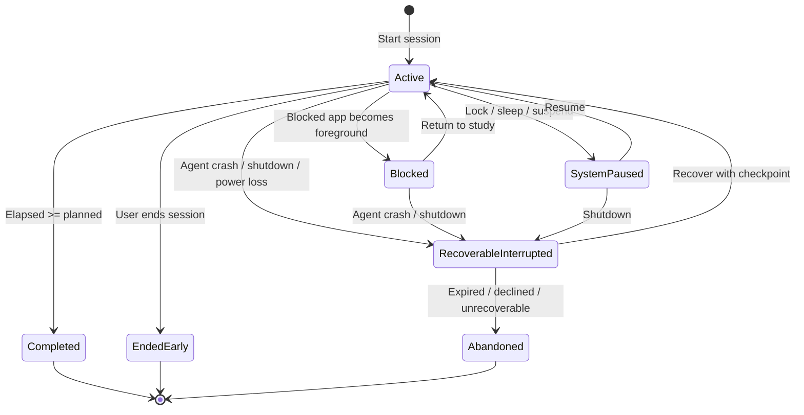

# Domain and Business Rules

**Product:** Boundless Study  
**Status:** Draft for user review  
**Version:** 0.2  
**Last updated:** 2026-11-12  
**Related:** `functional-requirements.md`, `conceptual-data-model.md`, `../01-product/product-requirements.md`

## 1. Purpose

This document defines the rules that must remain true across the UI, agent, service, extension, database, tests, and future modules. It is the authority for session timing, blocking behavior, reward eligibility, XP, streaks, achievements, and data integrity.

## 2. Glossary

| Term | Definition |
|---|---|
| Focus session | A timed study block with a selected profile, planned duration, optional task, and enforcement state. |
| Break session | A separate timed rest block. It is not a focus session and earns no XP. |
| Session elapsed time | Time accumulated while a focus session is running and the system is interactive, excluding lock, sleep, and blocking-overlay time. This drives the countdown. |
| Active-study time | The part of elapsed time that qualifies as active study after idle, overlay, and interruption rules are applied. This is the basis for session XP. |
| Idle time | Time after the idle threshold with no keyboard or pointer input. |
| Protection gap | Time during a focus session when configured website rules were not verified as applied. |
| Qualified session | A completed focus session with at least 10 minutes of active-study time. |
| Local day | The calendar date in the user’s local timezone at the moment the qualifying event is recorded. |
| Reward event | A domain event that can create an append-only ledger entry. |
| Ledger | The append-only record of XP and future currency entries. Balances are derived from it. |
| Full mode | Installation with an elevated Windows service that supervises the agent. |
| Limited mode | Per-user installation without a Windows service. |
| Protected | The specific protection surface has been verified as active. It is not a general claim that the user cannot bypass the product. |

## 3. Time model

### 3.1 Clocks

- Persisted timestamps use UTC.
- Durations use a monotonic clock while the process is alive.
- The system wall clock is not trusted for elapsed-duration calculation.
- Each recorded event also stores the local UTC offset at the time of recording.
- Due dates use local calendar dates, not UTC instants.
- A detected wall-clock jump creates a diagnostic event but does not change accumulated duration.

### 3.2 Session elapsed time

Session elapsed time accumulates only when:

1. The focus session is in `Active`.
2. The agent is running and healthy.
3. The Windows session is interactive.
4. The machine is not locked or suspended.
5. No blocking overlay is active.

Session elapsed time does **not** require recent input. It is intended to represent session progress, not verified attention. The focus countdown uses this value.

### 3.3 Active-study time

Active-study time is the subset of session elapsed time that qualifies as study:

- It accumulates during `Active` when the user has produced input within the idle threshold.
- It stops after the idle threshold is reached.
- It stops while a blocking overlay is active.
- It stops while the system is locked or suspended.
- It does not accumulate during breaks.
- It is not stopped merely because browser protection is degraded; the gap is recorded separately.

The MVP idle threshold is **5 minutes**, fixed. The first 5 minutes after the last input remain counted; accumulation stops at the threshold. Active time resumes immediately on input.

This is an approximation, not proof of attention. Reading or watching without input may undercount. The UI must label the metric as “active-study time” and explain the limitation. A future release may add an explicit passive-study mode.

### 3.4 Break time

Break time is measured separately. It does not count toward focus elapsed time, active-study time, XP, or streaks.

### 3.5 Session completion

A focus session reaches `Completed` when:

- Session elapsed time is greater than or equal to the planned focus duration.
- The session has not already ended.
- The completion transaction commits successfully.

Active-study time may be below 10 minutes even when the session completes. The session is completed, but it is not qualified for XP or streak credit.

### 3.6 Checkpoints

- The agent writes a session checkpoint at least every 10 seconds and on every state change.
- A crash may lose at most the current checkpoint interval.
- Downtime after the last checkpoint is never credited.
- A checkpoint includes session state, elapsed seconds, active seconds, idle seconds, protection gaps, violation counters, last update time, and profile.
- Recovery never invents time.

## 4. Focus profiles

### 4.1 Built-in profiles

The MVP has three built-in profiles. They share one global blocked-app and blocked-site configuration unless a later release adds per-profile rules.

| Rule | Flexible | Balanced | Strict |
|---|---|---|---|
| Blocking configured apps/sites | No | Yes | Yes |
| Early-exit confirmation | None | Confirmation + 10-second cooldown | Typed confirmation + 30-second cooldown |
| Temporary exceptions | Not applicable | Up to 2 per session, 5 minutes each | Up to 1 per session, 2 minutes, after 30-second delay |
| Browser extension required when website rules exist | No | No, but protection is reported as unavailable | Yes, before the session can start |
| XP rate per active minute | 2 | 3 | 4 |
| Website protection status when no extension | Not required | `Unavailable` if site rules exist | Session cannot start if site rules exist |
| Enforcement character | Timer and reminders | Best-effort blocking | Best-effort blocking with greater friction |

### 4.2 Profile rules

- A profile never blocks “everything.” It blocks only the configured application and website rules.
- Strict does not guarantee that a user cannot bypass the product.
- If no distractions are configured, the pre-session screen states that protection is not configured. The user may still start the session.
- The selected profile is stored on the session for history and reward calculation.
- Changes to blocked apps or sites during an active session apply to the next session, except a granted temporary exception.
- The user can always end a session. Friction is transparent and documented, not a trap.

### 4.3 Early exit

- Flexible ends immediately after confirmation-free action.
- Balanced requires an explicit confirmation and a 10-second cooldown.
- Strict requires the user to type a displayed confirmation phrase and wait through a 30-second countdown.
- Early exit records `EndedEarly`, the reason category, and remaining time.
- Early exit may earn partial XP under section 8.
- Early exit is never described as a failure of the person. UI copy should be neutral and factual.

## 5. Focus session state machine

### 5.1 State rules

- `Active`: elapsed and active time may accumulate; enforcement is active for the profile.
- `Blocked`: a blocked application is foreground and the overlay is active. Elapsed and active time pause. Enforcement rules remain configured.
- `SystemPaused`: the machine is locked or suspended. Elapsed and active time pause. No blocking action is taken while the desktop is unavailable.
- `Completed`: terminal and successful. Blocking is lifted.
- `EndedEarly`: terminal. Blocking is lifted.
- `RecoverableInterrupted`: terminal only until recovery is attempted. The checkpoint is preserved.
- `Abandoned`: terminal. Blocking is lifted. Partial XP may be awarded if active time qualifies.

### 5.2 Recovery rules

- On agent restart, the latest checkpoint is loaded.
- If the session has not completed and the checkpoint is less than 24 hours old, the session returns to `Active` with a recovery marker.
- Restrictions are reapplied immediately after recovery. The UI displays a recovery notice.
- Downtime is not credited.
- If the session had already reached planned elapsed time at the checkpoint, it is finalized as `Completed` using the checkpoint.
- If the checkpoint is older than 24 hours, malformed, or cannot be reconciled, the session becomes `Abandoned`.
- A user may explicitly abandon a recovered session.
- Full mode service supervision may restart the agent. Limited mode requires the agent to be started again by the user or per-user startup.

### 5.3 Sleep, lock, and power

- On lock or suspend, the agent pauses the session and checkpoints.
- On resume, the session returns to `Active`; elapsed downtime is not counted.
- On shutdown, the session is checkpointed as `RecoverableInterrupted`.
- On login, recovery follows section 5.2.
- Fast user switching does not merge sessions across Windows accounts.

### 5.4 One active session

- At most one focus session and one break session may be active for a local profile.
- A break cannot be active while a focus session is active.
- Starting a second focus session while one is active is rejected with a clear message.
- An unresolved `RecoverableInterrupted` session counts as blocking: the app offers Resume or Discard, and abandons the session automatically after 24 hours of unresolved age (A6, approved 2026-11-19; implemented). The pending session is exposed by `GetPendingFocusSessionHandler`. Resume is refused once the interruption is at least 24 hours old (the boundary is inclusive at exactly 24:00:00), and the session is abandoned exactly once through the normal terminal-reward path when the user resumes or starts a new session. `InterruptedAtUtc` records the anchor; a legacy row without it falls back to `UpdatedAtUtc`, and a future/skewed timestamp is treated as zero age.

## 6. Break sessions

- A break can start only when no focus session is active.
- Break durations are 1–60 minutes; default 5 minutes.
- Blocking is disabled during a break.
- Break elapsed time uses a monotonic clock and pauses during system lock or sleep.
- A break can end early.
- Break completion does not award XP and does not change streaks.
- A break may be linked to the preceding focus session for display, but it is a separate record.
- Long-break cycles and automatic Pomodoro sequencing are deferred.

## 7. Blocking rules

### 7.1 Application guard

- The user selects blocked applications by installed or running executable.
- Matching uses the normalized executable path when available, with a normalized executable name as fallback.
- The agent detects foreground changes through user-session Windows foreground events and a bounded polling fallback.
- A grace period of 3 seconds applies before the overlay appears.
- When a blocked application remains foreground after the grace period, the session enters `Blocked`.
- The overlay is an agent-owned topmost window in the interactive session. It names the application and offers “Return to study” and “End session.”
- The agent MUST NOT terminate, suspend, inject into, or modify another process.
- System-critical processes, accessibility tools, the agent, the UI, and the service are excluded from blocking. The approved baseline is exactly 24 targets and is grow-only (A3, approved 2026-11-19; the three missing accessibility targets VoiceAccess.exe, LiveCaptions.exe, and AtBroker.exe approved 2026-11-22, completing the 24-target baseline in `BlockingRules.cs`). The set is immutable at runtime, rule creation rejects protected targets using both the supplied name and the file name derived from the path (with bidirectional extension normalization), and `BlockedApp.EnsureTargetCanBeBlocked` is the runtime guard for the future blocking engine. Windows 11 accessibility coverage must be verified before release or before blocking is enabled.
- Blocking is active only during `Active`, `Blocked`, and `SystemPaused` focus states. It is not active during breaks.
- Window titles, document names, and content are not stored.
- Violation count, start/end time, duration, and executable identifier are stored.

**Application target coverage states**

The app reports each blocked target with one of these states before the session and in diagnostics:

| State | Meaning |
|---|---|
| `Supported` | The target is a user-session executable, the foreground-detection mechanism is available, and the overlay can be shown at the agent's integrity level. |
| `Unsupported` | The target is an elevated or protected process, a fullscreen-exclusive surface that suppresses the overlay, a process in another Windows session, or otherwise cannot be detected or overlaid by a standard-integrity per-user agent. |
| `Unverified` | The capability check has not completed or could not be completed. |

`Unsupported` and `Unverified` targets are never shown as `Protected`. The pre-session summary lists them and explains the limitation before the user starts.

**Application blocking in Limited mode**

Limited mode MUST implement best-effort application blocking through the per-user agent when the supported Windows mechanisms are available. The requirement is to implement the capability and report it honestly, not to guarantee that every application can be blocked.

- Available without administrator rights: user-session foreground detection, process identity, normalized executable matching, the 3-second grace period, and an agent-owned overlay.
- Requires administrator privileges or is outside Limited mode: installing the Windows service and service-supervised agent recovery (Full mode only); reliable detection or overlay of elevated/protected processes from a standard-integrity agent; applications in other Windows sessions or on the secure desktop; kernel-level, cross-session, or tamper-proof enforcement. Neither mode uses a kernel driver or process injection.
- If the overlay cannot be shown, the agent pauses the session, records an enforcement failure, shows a persistent notice naming the affected target, and credits no blocked time as study.
- Limited mode reports supervision as `Best effort`, not `Supervised`. Full mode adds service supervision and recovery; it does not add system-wide coverage, elevated-target coverage, or a tamper-proof guarantee.
- Limited mode cannot promise system-wide or tamper-proof enforcement because the agent runs at the signed-in user's integrity level, in one interactive session, and can be stopped by that user. Windows provides no supported standard-user API that can guarantee foreground detection or overlay above higher-integrity or protected windows.

### 7.2 Browser Guardian

- Website rules apply to Chrome and Edge through the MV3 extension.
- A blocked domain is blocked for HTTP and HTTPS requests while the focus session is active.
- A blocked domain matches its subdomains. Explicit allow rules take precedence over block rules.
- IP addresses may be matched exactly. URL paths, query strings, regular expressions, and wildcard TLDs are out of scope for MVP.
- Domain validation normalizes case, strips a leading `www.`, rejects invalid hostnames, and rejects non-HTTP schemes.
- The extension redirects blocked requests to an extension-hosted explanation page.
- Rules are applied on session start and removed on completion, early exit, abandonment, or break start.
- Rules MUST be reapplied after browser restart, extension service-worker wake, or extension update.
- The extension stores an expiry for the active session. If the agent disappears, the extension clears rules at expiry.
- The extension records no browsing history, page content, cookies, or form data.
- Incognito access is not guaranteed. The app must detect and disclose when incognito access is unavailable.
- Browser internal pages, extension pages, other browsers, guest profiles, and separate browser profiles outside the extension’s scope are not enforceable.
- Website protection status is `Protected` only when the extension is connected, the bridge is healthy, rules are applied, and the heartbeat is fresh.
- Heartbeat timeout is 30 seconds.
- A protection gap starts when status leaves `Protected` during a focus session.
- A protection gap does not stop active-study time. It is recorded and displayed.

### 7.3 Temporary exceptions

- A temporary exception may target one blocked application or one blocked domain.
- The exception is scoped to the active session and expires automatically.
- Balanced: maximum 2 exceptions per session, maximum 5 minutes each.
- Strict: maximum 1 exception per session, maximum 2 minutes, with a 30-second delay before activation.
- Flexible: not applicable.
- Every exception is logged with target, start, expiry, and reason category.
- The block resumes automatically at expiry.
- Exceptions do not change the global blocklist or allowlist.

### 7.4 Protection status vocabulary

| Status | Meaning |
|---|---|
| `NotRequired` | No relevant rules are configured. |
| `NotConfigured` | No application or website rules exist for the selected profile. |
| `Protected` | The relevant surface is verified active and fresh. |
| `Degraded` | Protection was active but is no longer verified, or a required component failed. |
| `Unavailable` | The required component is absent or blocked by policy. |
| `Unknown` | Check not completed. |

The UI MUST use these distinctions. “On” is not a synonym for “protected.”

## 8. Economy Rule Version 1 (`ECONOMY-1`)

### 8.1 Principles

- Rewards attach to verified domain events, never to application launch or passive presence.
- The ledger is append-only.
- Every reward has an idempotency key.
- Session completion and reward creation occur in one database transaction.
- The local owner can edit the database; this is a motivation system, not an anti-cheat system.
- The numerical rules in this section are a frozen MVP baseline, not live-tuning values.

### 8.2 Rule version and freeze

- The MVP economy version identifier is **`ECONOMY-1`**, frozen on 2026-11-12.
- `ECONOMY-1` covers XP rates, outcome multipliers, the minimum active-study threshold, the session daily cap, task XP, achievement XP, the level curve, and streak eligibility.
- Every reward transaction stores `EconomyRuleVersion = "ECONOMY-1"` on the ledger entry. A session also stores `EconomyRuleVersion` for the rule used for its award.
- The completion summary and diagnostics display the rule version that generated the award.
- Changing any frozen value requires a new version (`ECONOMY-2`, `ECONOMY-3`, and so on), a recorded decision, and new acceptance vectors.
- Historical ledger entries are never silently recalculated. A later version applies only to rewards created after it is activated.
- Acceptance tests use the exact values below. A test may not substitute a live-tuned value.
- Tokens are not part of `ECONOMY-1`. The MVP creates no `TOKEN` ledger entries, displays no token balance, and exposes no token earning, spending, or token UI. The ledger schema reserves `TOKEN` for a future version.

### 8.3 Session XP and completion eligibility

- Session XP requires at least **10 minutes** of active-study time, meaning `activeSeconds >= 600`.
- `activeMinutes = floor(activeSeconds / 60)`.
- Profile rate per active minute:
  - Flexible: **2 XP**.
  - Balanced: **3 XP**.
  - Strict: **4 XP**.
- Outcome multiplier:
  - `Completed`: **1.0**.
  - `EndedEarly`: **0.5**.
  - `Abandoned`: **0.5**.
- `rawXp = activeMinutes * rate * multiplier`.
- `awardedXp = floor(rawXp)`, then reduced to the remaining daily session-XP balance.
- A session with fewer than 10 active minutes awards **0 session XP**, even if it reached `Completed`.
- A completed session with at least 10 active minutes is a **qualified session** and is eligible for streak credit.
- An ended-early or abandoned session is never streak-qualified, even when it earns partial XP.
- Session XP is awarded once per session, at its terminal reward state. Starting a session, pausing, checkpointing, or recovering does not award XP.
- A completed session that crosses midnight uses the local date at completion for the cap and streak.
- A session that is recovered and later completed uses the completion multiplier once. A session that is abandoned uses the 0.5 multiplier once.
- `RecoverableInterrupted` is not a terminal reward state. No ledger entry is created until the session becomes `Completed` or `Abandoned`.
- A completed session with less than 10 active minutes still appears as completed in history and insights but awards no session XP and does not qualify the day for the streak.

### 8.4 Daily session-XP cap

- Session XP is capped at **300 XP per completion local day**.
- The cap applies across all profiles and sessions for that local day.
- `available = max(0, 300 - sessionXpAlreadyAwardedOnLocalDate)`.
- `award = min(computedAward, available)`.
- A final session may earn only the remaining balance. For example, with 280 session XP already awarded, a session computed at 30 XP awards 20 XP.
- Unused cap does not carry forward to another day.
- When the cap is reached, additional session XP is **0** for that local day.
- Task XP and achievement XP are separate and do not consume the session cap.
- The cap calculation occurs inside the same transaction that creates the session-XP entry, so concurrent or retried requests cannot exceed 300.

### 8.5 Task XP

- Completing a task awards **25 XP** once.
- The first valid transition to `Done` creates the award.
- Reopening and re-completing the task does not create another award.
- Deleting a task does not remove previously awarded XP.
- Task XP is not counted against the session XP daily cap.
- Task completion is allowed without a focus session, but the task itself must exist and be valid.
- A task deleted before its first completion cannot be completed and awards nothing. A soft-deleted task that was already completed keeps its historical award.
- Recreating a task with the same title creates a new task identity and can earn its own one-time completion award.

### 8.6 Achievement XP

- Each achievement has a fixed one-time XP award.
- Achievement XP is not counted against the session XP daily cap.
- Achievement unlock and its ledger entry occur in one transaction with the source event that satisfies the criteria.
- If one source event satisfies multiple achievements, all unlocks and ledger entries commit in the same transaction, in ascending achievement-code order. Partial unlock is not allowed.
- Achievement evaluation may be deferred for presentation during a focus session, but the unlock and ledger entry are not deferred to a later session. Presentation is queued; persistence is atomic with the source event.
- An achievement can unlock once per local profile.
- A duplicate unlock request returns success-with-no-change and creates no second entry.

### 8.7 Level curve

- 500 XP per level.
- `level = min(50, floor(totalXp / 500) + 1)`.
- Total XP continues to be recorded after level 50.
- Level-up feedback is derived from the XP total before and after a reward transaction.
- Level milestones do not create separate XP entries.
- Level is a derived value; it is never edited directly.

### 8.8 Streak

- A qualified day has at least one completed focus session with 10 or more active minutes.
- The current streak increments on the first qualified day after the previous qualified local day.
- A missed day resets the current streak to 0 until the next qualification, which becomes 1.
- The longest streak is retained.
- No streak freeze, purchase, or retroactive repair exists in MVP.
- Streak uses the recorded local date at session completion.
- Timezone changes do not rewrite historical streak days.
- A break does not affect streak.
- Ended-early and abandoned sessions do not qualify a day, even when they earn partial XP.

### 8.9 MVP achievement definitions and XP (`ECONOMY-1`)

| ID | Name | Criteria | XP |
|---|---|---|---|
| ACH-001 | First Focus | Complete the first qualified focus session. | 50 |
| ACH-002 | One Hour | Accumulate 60 verified active-study minutes. | 75 |
| ACH-003 | Three-Day Rhythm | Reach a 3-day streak. | 100 |
| ACH-004 | Deep Work | Complete 5 Strict focus sessions with at least 10 active minutes. | 100 |
| ACH-005 | Task Finisher | Complete 10 tasks. Eligibility uses lifetime completed-task history: archiving or soft-deleting a task does not erase its contribution, and reopening does not erase an earned achievement or duplicate rewards (approved 2026-11-19). | 75 |

Achievement names are functional product copy, not visual approval. Badge art is blocked pending references.

`ECONOMY-1` fixes the XP values in this table. The criteria are the MVP eligibility definitions, not economy calculation values.

### 8.9.1 Achievement-definition change control

- An `AchievementCode` permanently identifies one eligibility definition.
- `CriteriaType` and `Threshold` must not change, be overwritten, or be deleted under an existing `AchievementCode`; changing eligibility requires a new `AchievementCode`.
- Achievement definitions must not be silently overwritten or deleted.
- `EconomyRuleVersion` identifies only the economy rules used to calculate `XpAward`. An XP-only change requires a new economy version and does not change achievement eligibility.
- Historical `UserAchievement` records retain their original `AchievementCode` and remain interpretable through the retained immutable definition.
- Replacement, migration, or retirement that could create duplicate achievement rewards requires a separately documented decision before implementation.
- No criteria version or unlock-time criteria snapshot is added for the MVP.

### 8.10 Ledger, idempotency, and duplicate prevention

- Ledger entries are immutable.
- A unique idempotency key prevents duplicate awards.
- Key form: `<sourceType>:<sourceId>:<currency>`.
- Exact MVP keys:
  - Session completion: `SessionCompletion:<sessionId>:XP`.
  - Session partial award: `SessionPartial:<sessionId>:XP`.
  - Task completion: `TaskCompletion:<taskId>:XP`.
  - Achievement unlock: `AchievementUnlock:<achievementCode>:XP`.
- A session has exactly one terminal reward state, so it can produce at most one of the two session keys.
- Supported currency codes: `XP` for MVP; `TOKEN` is reserved for future releases.
- MVP creates no token entries and exposes no token balance, earning, spending, or token UI.
- Token data, if introduced later, must survive installation-mode upgrades and migrations.
- Balances are derived by summing ledger entries; a cached total may be stored for performance but must be rebuildable.
- Negative entries are not exposed in MVP. Future corrections use explicit adjustment entries with their own idempotency keys; existing entries are never edited or deleted.
- If a reward transaction fails, the source state change must not be committed as rewarded.
- If the same reward is requested again, the unique constraint is treated as success-with-no-change and the existing entry is returned.
- A retry after an uncertain result first looks up the idempotency key. If the entry exists, it verifies the source and returns the existing result; it does not create a second entry.
- The agent is the sole database owner and the only process that opens or writes the database.

### 8.11 Recovery and transaction boundaries

- The session terminal transition, its session-XP entry, any achievement unlock and achievement-XP entry caused by that event, the streak projection, and cached totals commit in one database transaction.
- The task completion transition, its task-XP entry, any achievement unlock caused by the task count, and cached totals commit in one database transaction.
- A crash before commit leaves no terminal state, no ledger entry, no achievement unlock, and no cache update. Recovery replays from the checkpoint and may award once when the terminal transition commits.
- A crash after commit leaves the terminal state and the ledger entry present. Recovery sees the idempotency key and makes no second award.
- A crash during a multi-achievement transaction rolls back all unlocks and all entries; a retry may commit all of them once.
- Recovery never recalculates historical awards. It may rebuild a missing cache from the ledger and may create a missing entry only when the source terminal state is proven and no entry exists, using the source session's stored `EconomyRuleVersion`.
- If a terminal source has no ledger entry and the stored rule version cannot be established, the agent records an integrity diagnostic and surfaces a recovery state instead of inventing an award.
- The ledger can rebuild total XP, level, daily session-XP totals, and achievement state. A cached value is never the only copy of a reward.

### 8.12 Parameterized acceptance vectors (`ECONOMY-1`)

These vectors are the frozen numerical expectations for acceptance tests. `Prior session XP` means session XP already awarded on the same completion local date. All values are XP unless stated otherwise.

| Vector | Scenario | Inputs | Expected |
|---|---|---|---|
| TV-01 | Normal completion, Flexible | 25 active min, completed, prior 0 | 50 XP; 0 remaining cap consumed beyond 50; streak qualified. |
| TV-02 | Normal completion, Balanced | 22 active min, completed, prior 0 | 66 XP; streak qualified. |
| TV-03 | Normal completion, Strict | 30 active min, completed, prior 0 | 120 XP; streak qualified. |
| TV-04 | Ended early, Balanced | 12 active min, ended early, prior 0 | 18 XP; not streak qualified. |
| TV-05 | Abandoned, Balanced | 20 active min, abandoned, prior 0 | 30 XP; not streak qualified. |
| TV-06 | Recovery to completion | 25 active min, recovered, completed, prior 0 | 75 XP once; no separate partial award; streak qualified. |
| TV-07 | Daily cap, partial award | 10 active min, completed Balanced, prior 280 | Computed 30; award 20; day total 300. |
| TV-08 | Daily cap reached | 30 active min, completed Strict, prior 300 | Computed 120; award 0; day total 300. |
| TV-09 | Duplicate task completion | First Done, then reopen and Done again | First 25 XP; second 0; one `TaskCompletion:<taskId>:XP` entry. |
| TV-10 | Duplicate achievement award | ACH-001 unlocked twice | First 50 XP; second 0; one `AchievementUnlock:ACH-001:XP` entry. |
| TV-11 | Multiple achievements, one event | First qualified session has 60 active min, Balanced | Session 180 XP; ACH-001 50; ACH-002 75; all in one transaction; total 305. |
| TV-12 | Crash before commit | Completed Balanced 25 min; transaction fails before commit; retry | No award before retry; retry commits 75 XP once; no duplicate. |
| TV-13 | Crash after commit | Completed Balanced 25 min; transaction commits; process dies; retry | 75 XP already present; retry returns existing; total 75. |
| TV-14 | Retry after uncertain completion | Request times out after commit; client retries | Same ledger entry returned; one row; total unchanged. |
| TV-15 | Rounding | 13 active min, ended early Balanced | `13 * 3 * 0.5 = 19.5`; award 19 XP. |
| TV-16 | Level boundaries | Totals 0, 499, 500, 24,499, 24,500, 25,000, 25,001 | Levels 1, 1, 2, 49, 50, 50, 50; total XP still recorded above 25,000. |
| TV-17 | Below minimum active time | 599 active sec, completed Balanced | 0 XP; not streak qualified; session remains completed. |
| TV-18 | Task re-completion | Task Done, reopen, Done again | 25 XP once; no second entry. |
| TV-19 | Partial cap on early exit | 12 active min, ended early Balanced, prior 290 | Computed 18; award 10; day total 300. |
| TV-20 | Cap applies per local completion day | 300 XP on day 1; qualified session after local midnight on day 2 | Day 1 cap does not reduce day 2; day 2 award uses its own 300 XP balance. |

## 9. Task and subject rules

### 9.1 Subjects

- A subject has a required name and an optional description.
- Subject names are trimmed, non-empty, and limited to 100 characters.
- A subject can be archived. Archived subjects do not appear in new-task selection.
- Archiving a subject does not delete its tasks or history.

### 9.2 Tasks

- A task has a required title, optional subject, optional due date, optional estimate, priority, status, and notes.
- Title is trimmed, non-empty, and limited to 200 characters.
- Priority is Low, Normal, or High. Default is Normal.
- Status is Todo, InProgress, Done, or Archived.
- Estimate is 5–600 minutes in 5-minute increments.
- Due date is a local calendar date.
- “Planned for today” is an explicit manual flag/date. The MVP does not auto-schedule.
- A task can be linked to at most one focus session at a time.
- A task can have many historical session links.
- Task completion is a valid transition to Done.
- The first valid completion awards XP; later completions do not.
- Deletion is soft-delete and retains session-history integrity.
- No recurring tasks, subtasks, dependencies, or automatic prioritization in MVP.

### 9.3 History snapshots

- Focus sessions retain a title snapshot and subject-name snapshot for stable historical display.
- Renaming a task or subject does not rewrite past session snapshots.
- Deleting a task does not make historical sessions unreadable.

## 10. Date, timezone, and week rules

- All persisted event times are UTC.
- Local dates are derived with the offset recorded at event time.
- Daily XP cap uses the completion local date stored on the ledger entry.
- Streak qualification uses the completion local date.
- Insights group sessions by completion local date.
- The week starts on Monday in MVP.
- Due dates are local dates without a time component.
- Daylight-saving transitions do not change elapsed durations.
- If the wall clock jumps across a date boundary, the event is recorded with the resulting local date and a clock-change diagnostic. The local owner can manipulate the clock; the product does not claim anti-cheat protection.

## 11. Data integrity rules

- Foreign keys are mandatory.
- Durations and counters are non-negative.
- A session cannot have `Completed` state without a completion timestamp.
- A session cannot have `Completed` state with elapsed time below the planned duration unless it was finalized from a recovery checkpoint that met the threshold.
- A terminal session cannot return to active except `RecoverableInterrupted`.
- A reward ledger entry must reference an existing source.
- Every reward ledger entry stores the economy rule version that generated it.
- A session terminal state and its reward entry commit atomically.
- An achievement can unlock once per local profile.
- A task completion reward can exist once per task.
- A session can produce at most one session XP entry.
- One active focus session per local profile.
- One active break session per local profile.
- No application or website rule may target the agent, UI, service, native bridge, or required system process.
- Blocklist/allowlist domains are normalized and unique per list type.
- The database must be backed up before a destructive migration.
- Corruption must never be silently “repaired” by deleting user history.

## 12. Edge cases

| Case | Rule |
|---|---|
| Strict selected with site rules and no extension | Session start is blocked with an explanation and a path to install/reconnect or choose another profile. |
| Strict selected with no blocked apps or sites | Warning that nothing is configured; session may start with `NotConfigured` protection. |
| Extension disconnects mid-session | Session continues, protection becomes `Degraded`, gap is recorded, UI warns persistently. |
| Agent crashes | Session becomes recoverable; Full mode service may restart the agent; downtime is not credited. |
| Service stopped in Full mode | App reports degraded supervision; existing session continues if the agent lives; next launch reports service unavailable. |
| User changes system clock | Monotonic durations unaffected; local-date effects recorded; no anti-cheat claim. |
| Session crosses midnight | Assigned to completion local day for XP, streak, and insights. |
| User completes task twice | First completion awards; later transitions do not. |
| XP cap reached | Additional session XP is zero; fixed task/achievement XP may still apply. |
| Token data present from a future build | Preserved through mode upgrade and migration; not exposed in MVP UI. |
| Database locked | Agent retries with a bounded wait; UI shows a non-destructive wait/error state. |
| Backup fails | User is notified; the app continues but displays backup status as unhealthy. |
| Overlay fails | Session pauses, enforcement failure is recorded, user is notified; blocked time is not counted as study. |
| Fullscreen-exclusive app covers overlay | Limitation disclosed; agent records detection failure where possible; no false protection claim. |
| User uninstalls during a session | Session is ended/checkpointed if possible; data choice is honored; extension cleanup guidance is shown. |

## 13. Worked examples

### Example 1 — Completed Balanced session

- Planned: 25 minutes.
- Elapsed at completion: 25 minutes.
- Active-study time: 22 minutes.
- Protection: `Protected` throughout.
- XP: `floor(22) * 3 * 1.0 = 66 XP`.
- Streak: qualified because completed and active >= 10 minutes.

### Example 2 — Early exit

- Planned: 50 minutes.
- Active-study time: 12 minutes.
- User ends early in Balanced.
- XP: `floor(12) * 3 * 0.5 = 18 XP`.
- Streak: not qualified because the session was not completed.

### Example 3 — Interrupted session

- Planned: 45 minutes.
- Checkpointed active-study time: 20 minutes.
- Agent crashes; downtime is not credited.
- User does not recover; session becomes `Abandoned`.
- XP: `floor(20) * 3 * 0.5 = 30 XP`.
- Streak: not qualified.

### Example 4 — Daily cap

- User completes 25-minute Balanced sessions with 25 active minutes each: 75 XP each.
- After three sessions: 225 XP.
- A fourth session computes 75 XP but may earn only the remaining 75 XP, reaching 300 XP.
- A fifth qualified session earns 0 session XP for that local day.
- A task completed that day still earns 25 XP.
- If the fourth session had computed 90 XP, it would award only the remaining 75 XP; the unused 15 XP does not carry forward.

### Example 5 — Partial cap

- Prior session XP on the local day: 280 XP.
- A completed Balanced session has 10 active minutes: `10 * 3 * 1.0 = 30 XP` computed.
- Available cap: `300 - 280 = 20 XP`.
- Award: `min(30, 20) = 20 XP`.
- Day total: 300 XP. No XP carries to the next day.

## 14. Change control

- `ECONOMY-1` is the frozen MVP economy baseline. Its rates, multipliers, minimum active time, daily cap, task XP, achievement XP, level curve, and streak eligibility are fixed for acceptance testing.
- A change to any frozen value requires a new economy version, a recorded decision, updated acceptance vectors, and a new changelog entry.
- Historical ledger entries are not recalculated when a new version is activated. Each entry keeps the `EconomyRuleVersion` that created it.
- A new version applies only to rewards created after activation.
- Session summaries and diagnostics must display the economy rule version used for the award.
- The idle threshold and profile friction are behavior rules, not economy values; changing them still requires a documented decision and regression testing.
- Achievement eligibility definitions are immutable per achievement code. Changing eligibility requires a new code and is not an economy-version change; see §8.9.1.
