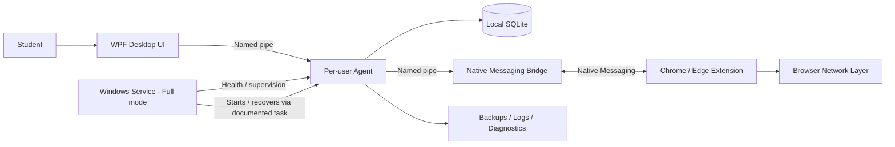
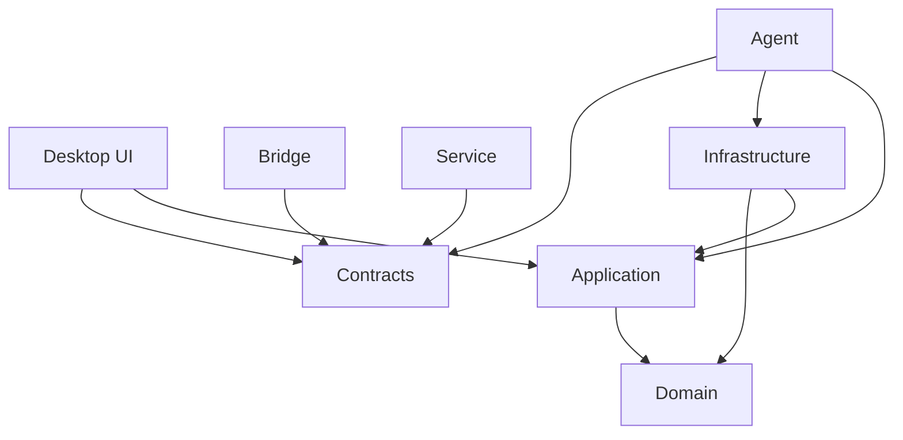
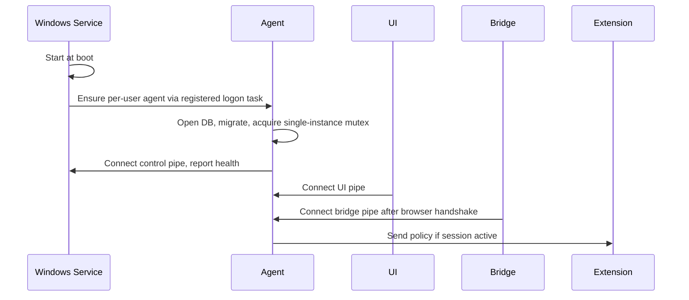
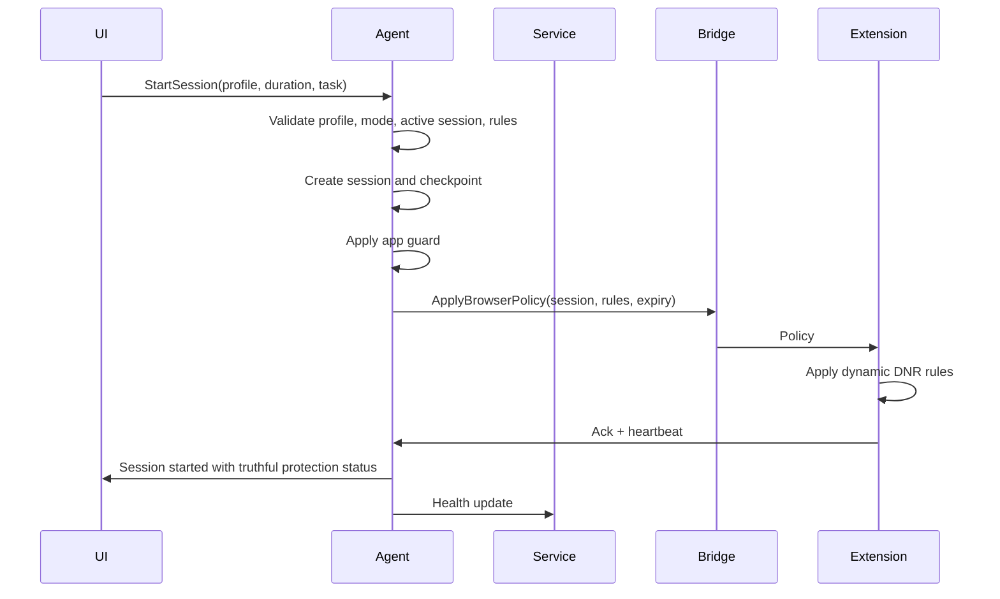

# System Architecture

**Product:** Boundless Study  
**Status:** Draft for user review  
**Version:** 0.2  
**Last updated:** 2026-11-12  
**Related:** `../01-product/product-requirements.md`, `../02-requirements/domain-business-rules.md`, `../02-requirements/conceptual-data-model.md`, `adr/README.md`

## 1. Architecture goals

- Keep the core product usable without administrator rights.
- Keep local-first operation and user data ownership intact.
- Make Full mode stronger through service supervision, not through hidden or kernel-level enforcement.
- Keep shared study functionality independent of the privileged service.
- Use separately executing components only where Windows or the browser requires it.
- Make all cross-process communication versioned, bounded, and diagnosable.
- Support future planner, companion, challenges, tokens, and themes without replacing the core data model.

## 2. Architectural style

Boundless Study is a **modular monolith with separately executing front ends and platform adapters**:

- One shared domain and application core.
- A WPF desktop client.
- A per-user agent that owns study state and local data.
- An optional Windows service for Full-mode supervision.
- A native-messaging bridge for Chromium browsers.
- A Manifest V3 browser extension.
- SQLite as the local system of record.

The service is not a microservice, a cloud component, or the owner of study data. It is a supervisor and health authority.

## 3. System context

## 4. Process and component model

| Component | Runs as | Responsibility | Must not do |
|---|---|---|---|
| `BoundlessStudy.Desktop` | Per-user interactive process | WPF UI, MVVM presentation, navigation, accessibility, commands through the agent. | Write SQLite directly; enforce blocking; own rewards. |
| `BoundlessStudy.Agent` | Per-user background process, tray icon | Sole owner of SQLite and the only process that opens it, for reads and writes; session engine; active/idle timing; app guard; overlay; pipe servers; extension policy coordination; backup coordination. | Require administrator rights; install hidden persistence; write machine-wide policy without consent. |
| `BoundlessStudy.Service` | Windows service, Full mode only | Start at boot; monitor user sessions; supervise agent health; attempt documented recovery; record privileged health. | Display interactive UI; write user study data; terminate arbitrary apps; inject code; open network ports. |
| `BoundlessStudy.Bridge` | Per-browser native-messaging host | Translate browser Native Messaging frames to the agent protocol; validate origin; remain stateless. | Store study data; enforce policy itself; accept unapproved origins. |
| Browser extension | Chrome/Edge MV3 | Apply declarative site rules, show blocked page, heartbeat, clear/expire rules. | Collect browsing history; access page content; write local study data. |
| `BoundlessStudy.Domain` | Shared library | Entities, value objects, state machines, reward rules, validation, domain events. | Reference WPF, Windows APIs, EF Core, or browser code. |
| `BoundlessStudy.Application` | Shared library | Use cases, ports, orchestration, command/query contracts. | Contain UI or database implementation. |
| `BoundlessStudy.Infrastructure` | Shared library | EF Core SQLite, file system, clocks, logging adapters, backup implementation. | Contain product policy that belongs in the domain. |
| Contracts | Shared library | Versioned IPC and Native Messaging DTOs and validators. | Contain business logic. |

## 5. Dependency rules

Rules:

- Domain references nothing outside the .NET base library.
- Application references Domain and defines ports.
- Infrastructure implements ports.
- UI references Application and Contracts, never Infrastructure directly except composition.
- Agent composes Domain, Application, Infrastructure, and Contracts.
- Service uses only the contracts and platform supervision it needs.
- Bridge uses Contracts and a small pipe client; no database or domain access.
- Extension is independent TypeScript and communicates only through the bridge.
- No circular project references.

## 6. Data ownership

- The agent is the **sole database owner** and the **only process that opens** `%LocalAppData%\BoundlessStudy\boundless.db`, for reads and writes.
- The UI sends commands and queries through the UI pipe. It never opens the database, copies it for reading, or falls back to direct file access.
- The bridge sends browser status and receives policy through a separate pipe. It stores no study data and has no database access.
- The service receives health and sends supervision commands through a control pipe. It never opens the study database.
- Migrations run in the agent before the UI can issue commands. The UI performs a schema-version handshake and never migrates the database.
- Backup and restore are coordinated by the agent so the database has one access boundary and one writer.
- Full and Limited modes use the same database and schema.
- Service machine state, if any, is stored separately under `%ProgramData%\BoundlessStudy\` and contains no study history.

### 6.1 Read and write access contract

- **Read request:** `protocolVersion`, `requestId`, `correlationId`, `queryType`, bounded parameters, `pageSize`, optional opaque `pageToken`, optional `snapshotToken`.
- **Read response:** echoed `requestId` and `correlationId`, `snapshotToken`, page records, `hasMore`, a stable sort key, and a status/error object.
- **Write request:** `protocolVersion`, `requestId`, `correlationId`, `commandType`, validated parameters, and an idempotency key for mutations.
- **Write response:** echoed `requestId`, `correlationId`, the committed result, and the idempotency key.
- **Timeouts:** default 5 seconds per request. Long operations report progress. A timeout does not authorize a direct database fallback or an unsafe blind retry; the client reconciles by request ID or idempotency key.
- **Cancellation:** the client sends a cancellation request naming the target `requestId`; the agent checks between pages and before commit where the operation permits cancellation.
- **Pagination:** default 100 records, maximum 500. Multi-page reads use keyset pagination and an opaque page token. A bounded snapshot lease provides a consistent view; `SNAPSHOT_EXPIRED` requires the UI to restart the query rather than mix snapshots silently.
- **Errors:** stable code, human-readable message, retryable flag, affected component, and no partial mutation. The UI maps the code to a recovery action.
- **Backup:** the agent uses SQLite's online backup mechanism or an equivalent consistent snapshot while it controls writes. The UI requests backup/restore and receives progress; it never copies the database file.
- **Migration:** the agent owns schema version, pre-migration backup, and migration execution. The UI reports an incompatible schema as a recovery/update state.

## 7. IPC and protocols

### 7.1 Named-pipe endpoints

| Endpoint | Server | Clients | Purpose |
|---|---|---|---|
| `\\.\pipe\BoundlessStudy.UI.<UserSid>` | Agent | Desktop UI | Commands, queries, summaries, health. |
| `\\.\pipe\BoundlessStudy.Bridge.<UserSid>` | Agent | Native bridge instances | Browser hello, heartbeat, policy, status. |
| `\\.\pipe\BoundlessStudy.Control.<UserSid>` | Service | Agent | Health reports and supervision commands. |

### 7.2 Common protocol rules

- Message-mode named pipes.
- Length-prefixed JSON frames with a maximum frame size of 1 MB.
- `protocolVersion`, `requestId`, `correlationId`, `messageType`, `timestampUtc`, and `payload` envelope.
- Request/response correlation and idempotency keys for mutations.
- Per-request timeout of 5 seconds; long operations report progress and support cancellation by target `requestId`.
- Bounded pagination for list and history queries, with opaque page tokens and snapshot-expiry handling.
- Unknown fields are rejected or ignored according to the declared compatibility policy; unknown message types are rejected.
- Schema validation occurs before domain dispatch.
- No arbitrary command execution, SQL, file path, or script payloads.
- Connection limits, backpressure, and rate limits exist per client role.
- Service and user pipes use user-SID-specific names and ACLs.
- The pipe server validates the client user SID and role. A valid user SID does not make a UI client a bridge client.
- A read query executes in one consistent WAL snapshot per response. Multi-page reads use a bounded snapshot lease; an expired lease returns `SNAPSHOT_EXPIRED` and the UI restarts the query.

### 7.3 Native Messaging

- Chromium native messaging framing: 4-byte little-endian length followed by JSON.
- Maximum host message size follows browser limits and a stricter application limit.
- The host manifest allowlist contains only the fixed Boundless Study extension origin.
- The bridge sends a hello containing extension ID, version, browser family, and protocol version.
- The agent rejects mismatched origins, unsupported versions, and malformed handshakes.
- The bridge reconnects after agent restart and forwards only allowed message types.
- The extension heartbeats every 15 seconds; the agent marks protection degraded after 30 seconds without a heartbeat.

## 8. Agent responsibilities

### 8.1 Lifecycle

- One agent instance per Windows user, enforced by a named mutex.
- Starts at user logon through a documented mechanism:
  - Full mode: service-supervised per-user launch task.
  - Limited mode: per-user startup registration.
- Can also be started by the UI or repair flow.
- Shows a tray presence while active.
- Closing the UI does not close the agent or end an active session.
- The agent checkpoints and shuts down cleanly when possible.

### 8.2 Session engine

- Owns the focus and break state machines.
- Owns monotonic elapsed/active timing and checkpointing.
- Owns task/session linkage, rewards, and summaries.
- Coordinates app guard and browser policy.
- Publishes session state to connected UI clients.
- Handles lock, sleep, resume, shutdown, and recovery.
- Rejects invalid transitions.

### 8.3 Enforcement

- App guard runs in the interactive session.
- Overlay windows are agent-owned and keyboard accessible.
- Browser policy is sent to the bridge and extension.
- The agent treats extension acknowledgment as required evidence for `Protected`.
- If the overlay cannot be shown, the agent pauses the session and reports an enforcement failure.
- Full mode does not change the overlay mechanism; it adds service supervision and recovery.
- Limited mode uses the same agent-owned foreground detection and overlay mechanisms, without service supervision. It reports supervision as `Best effort`.
- Both modes report each application target as `Supported`, `Unsupported`, or `Unverified`. Elevated, protected, fullscreen-exclusive, other-session, and secure-desktop targets may be `Unsupported`; they are never shown as `Protected`.
- Neither mode uses a kernel driver, process injection, or process termination. Neither mode claims system-wide or tamper-proof application coverage.
- When enforcement is unavailable for a target, the session pauses where required, the failure is recorded, and a persistent notice names the target and recovery action.

### 8.4 Data and backup

- Runs migrations.
- Performs integrity checks.
- Creates automatic and manual backups using a consistent SQLite snapshot method.
- Coordinates restore while preventing concurrent writes.
- Exposes diagnostics without personal content.

## 9. Service responsibilities and limits

### 9.1 Full mode supervision

- Starts at boot.
- Watches Windows session logon/logoff and user switching.
- Ensures the per-user agent is running for active interactive sessions.
- Receives agent heartbeats over the control pipe.
- Attempts documented restart after an unexpected agent exit.
- Rate-limits restart attempts to avoid loops.
- Records health and exposes repair diagnostics.
- Does not enforce blocking directly.

### 9.2 Stronger enforcement, honestly defined

Full mode is stronger because:

1. The service can detect and restart a stopped agent.
2. The service can reapply the active-session policy through the recovered agent.
3. The service starts at boot and is independent of the UI.
4. Health and failure are visible instead of silent.

Full mode is **not**:

- A kernel driver.
- A guarantee that the user cannot stop the service.
- A process-termination mechanism.
- An anti-cheat or parental-control system.
- Permission to hide components or modify undocumented Windows behavior.
- Additional application coverage beyond the same user-session foreground detection and overlay mechanisms. Elevated, protected, fullscreen-exclusive, other-session, and secure-desktop targets remain `Unsupported` or `Unverified` in both modes.
- A system-wide or tamper-proof application-blocking guarantee. The per-user agent runs at the signed-in user's integrity level and can be stopped by that user; the service adds supervision and recovery only.

### 9.3 Service account and least privilege

- The provisional service account is LocalSystem because starting a process in an interactive user session may require session token access.
- The exact least-privilege account and API path must be validated in Phase 3.
- If a lower-privilege design can meet supervision requirements, it is preferred.
- The service has no network listener and no user-data access.
- Service logs are machine-scoped and privacy-reviewed.

### 9.4 Restart mechanism

The preferred provisional mechanism is:

1. Installer registers a visible per-user logon task for the agent.
2. Service watches for the agent control-pipe heartbeat.
3. If the agent is absent for a threshold, the service requests the registered task for the active user session.
4. The service waits for reconnection with a cooldown and attempt limit.
5. If restart fails, the service marks supervision degraded and records a diagnostic.

This mechanism must be validated on Windows 11 for logon, fast user switching, policy restrictions, and service restarts. It must leave no hidden task. The task is shown in documentation and removed on uninstall.

## 10. Desktop UI

- WPF with MVVM.
- No direct database access.
- All commands and queries go through the UI pipe.
- The UI can be closed and reopened during an active session.
- If the agent is unavailable, the UI offers start, repair, or diagnostics instead of showing stale data.
- Full and Limited mode capability differences are displayed from live health, not a build-time assumption.
- Visual layout, color, typography, and assets remain blocked pending references.
- Accessibility is a platform concern, not a later visual theme.

## 11. Browser extension

- Manifest V3, TypeScript.
- Uses declarativeNetRequest for block/allow rules.
- Uses Native Messaging, storage, and alarms.
- Does not use browsing history or page content.
- Applies rules per active session with an expiry.
- Shows a blocked explanation page.
- Reconnects and reapplies policy after service-worker restart.
- Reports browser, version, incognito access, heartbeat, and rule status.
- Clears rules on session end, break, expiry, or explicit reset.
- Fails visibly when policy blocks installation or host launch.
- No silent extension installation is attempted.

## 12. Runtime flows

### 12.1 Full-mode startup

### 12.2 Limited-mode startup

- No service exists.
- The agent starts from the per-user startup registration or manual launch.
- The UI and bridge connect directly to the agent.
- The app shows `Best effort` supervision and never `Service protected`.

### 12.3 Session start

If Strict requires browser rules and no verified ack arrives, the session is not marked started as Strict. The user sees a recovery path.

### 12.4 Completion

1. Timer reaches planned elapsed time.
2. Agent transitions to `Completed`.
3. App guard stops; browser policy is cleared.
4. Reward transaction and session completion commit atomically.
5. UI receives summary data.
6. Achievement/level feedback is queued safely.
7. Service health remains independent.

### 12.5 Crash and recovery

- Agent crash: service detects missing heartbeat; session state remains checkpointed.
- Service attempts agent restart.
- Agent loads the latest checkpoint, reapplies policy, and reports recovery.
- No downtime is credited.
- If recovery is impossible, the session becomes `Abandoned`.
- Limited mode relies on user startup or UI repair.

## 13. Installation and upgrade

### 13.1 Full mode

- Requires administrator rights.
- Installs per-machine binaries under `Program Files\BoundlessStudy\`.
- Installs the Windows service.
- Registers the native host and fixed extension origin.
- Registers a visible per-user agent launch task.
- User data remains in `%LocalAppData%\BoundlessStudy\`.
- Service logs remain under `%ProgramData%\BoundlessStudy\Logs\` or the Windows Event Log, privacy-reviewed.

### 13.2 Limited mode

- No elevation.
- Installs per-user binaries under `%LocalAppData%\Programs\BoundlessStudy\`.
- Registers per-user startup and native host entries under HKCU.
- Uses the same user data path and schema.
- Displays best-effort enforcement.

### 13.3 Upgrade

- User initiates from Settings.
- Installer explains service and permissions.
- One elevation request.
- Privileged components installed.
- Agent restarted and connected to service.
- Health verified before showing Full mode.
- Data path, profile, tasks, settings, history, XP, achievements, and any future token data if present are unchanged.
- Failure or denied elevation leaves Limited mode intact.

### 13.4 Packaging

Provisional decision: signed EXE/MSI bootstrapper with per-user and per-machine components. MSIX is not assumed for Full mode because of service and Native Messaging constraints. See ADR-0010. The final installer technology must be validated in Phase 3.

## 14. Failure and degraded-state matrix

| Failure | Full mode | Limited mode | User-visible behavior |
|---|---|---|---|
| Service stopped | Supervision degraded; agent may continue | Not applicable | `Full mode — service unavailable`; repair guidance. |
| Agent stopped | Service attempts restart | User/UI attempts restart | Session recovered if checkpoint valid; otherwise abandoned. |
| UI closed | Agent continues | Agent continues | No data loss; reopen reconnects. |
| Bridge missing | Browser protection unavailable | Same | `Unavailable`; Strict with site rules cannot start. |
| Extension disabled | Protection degraded | Same | Persistent warning; gap recorded. |
| Browser policy blocks extension | Unavailable | Unavailable | Onboarding and Settings explain policy restriction. |
| DB locked | Agent retries | Agent retries | Wait/error state; no forced write. |
| DB corrupt | Recovery | Recovery | Restore/quarantine; no silent deletion. |
| Overlay failure | Session pauses | Session pauses | Enforcement failure; no study time credited. |
| Elevated, protected, or fullscreen-exclusive target | Detection or overlay may fail; report `Unsupported` or `Unverified` | Same | No `Protected` claim; persistent notice and recovery action where enforcement fails. |
| Service cannot restart agent | Degraded | Not applicable | Visible recovery action; no false supervision. |
| Upgrade failure | Remains Limited | Remains Limited | Data unchanged; retry or continue. |
| Uninstall during session | Session checkpoint/end best effort | Same | Data choice and extension guidance. |

## 15. Security boundaries

- Browser extension ↔ native host: browser-enforced origin and allowlist.
- Native host ↔ agent: named pipe, user SID, role, schema validation.
- UI ↔ agent: named pipe, user SID, UI role, bounded commands.
- Service ↔ agent: control pipe, service/agent role, health only.
- Agent ↔ SQLite: user-scoped filesystem ACL; agent-only database access.
- User ↔ data: local owner and administrators can access local files; this is disclosed.
- No network trust boundary in MVP.

## 16. Architecture risks

| Risk | Mitigation |
|---|---|
| Service restart design is fragile or policy-blocked. | Phase 3 spike; documented logon task; visible degraded mode; no overclaim. |
| Agent and UI duplicate data logic. | One application core; UI is a client; code review and dependency tests. |
| SQLite writer contention. | Sole agent-owned writer; WAL; bounded retries; no UI database access. |
| Native Messaging blocked by school policy. | Limited mode remains useful; explicit unavailable state. |
| Overlay cannot cover fullscreen apps. | Disclose; detect where possible; pause on enforcement failure. |
| Service account is over-privileged. | Validate least privilege; restrict functionality; no network; no user-data writes. |
| Packaging choice blocks service/native host. | Provisional EXE/MSI; validate before implementation. |
| Extension store delay. | Limited mode and developer/sideload test path; do not claim store availability before approval. |

## 17. Architecture decisions

See `adr/README.md` for the index. Key decisions:

- ADR-0001: Local-first architecture.
- ADR-0002: Per-user agent owns data and enforcement UI; service supervises.
- ADR-0003: Best-effort enforcement, no kernel driver.
- ADR-0004: Chrome/Edge MV3 with declarativeNetRequest.
- ADR-0005: SQLite and EF Core with an agent-owned single access boundary.
- ADR-0006: Append-only session events and reward ledger.
- ADR-0007: Full and Limited installation modes.
- ADR-0008: Visual references are authoritative.
- ADR-0009: MVP progression is XP, levels, streak, and achievements only.
- ADR-0010: Provisional packaging direction.

## 18. Open architecture questions

1. Can the service start the per-user agent through a visible Task Scheduler task on all supported Windows configurations?
2. Which service account and API best satisfy least privilege while allowing session supervision?
3. Which installer technology supports both per-user and per-machine modes, native host registration, and clean upgrade?
4. Can the extension obtain the minimum host permissions required for DNR in Chrome and Edge without requesting browsing history?
5. How should toast notifications be registered for the chosen packaging?
6. What is the fixed extension ID and store-distribution process?
7. Which Windows 11 builds are in the release test matrix?
